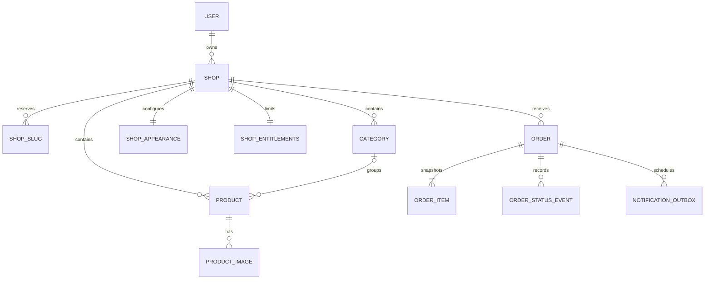

# Modelo de datos conceptual

Modelo conceptual original, seguido de la implementación autorizada del MVP. Base compartida con aislamiento por `shop_id`. Fechas UTC; presentación America/Argentina/Buenos_Aires. Importes enteros en centavos, moneda explícita; nunca float para dinero.

## Implementación de fase 1

La migración `2026_10_26_000001_create_catalog_platform.php` es la fuente de verdad ejecutable. Tablas efectivas: shops, categories, products, media, orders, order_items, order_events, outbox, daily_metrics y local_messages (visor local), más users/sessions/password resets/cache/jobs del framework.

Se redujo el modelo para el MVP: propietario único mediante shops.user_id; apariencia publicada/borrador y plan/cuotas en shops; imágenes de producto/logo en media; idempotencia en orders con índice único comercio/sesión/clave; historial en order_events. No hay cambio de slug habilitado, por lo que la dirección es estable y no se implementaron aliases aún. FKs compuestas protegen categorías, imágenes y líneas. Las entidades de suscripción/pagos permanecen futuras.

Motor local y de pruebas: MariaDB 11.8.9 en puerto 3318, datos exclusivos del workspace. Bases separadas vitrina, vitrina_test, vitrina_e2e y vitrina_restore_test. No utiliza datos ni servicio de XAMPP.

## Entidades de fase 1

| Entidad | Campos principales / relaciones |
|---|---|
| users | email único normalizado, password_hash, verified_at; autenticación y recuperación |
| shops | owner_user_id, public_id, slug, nombre, descripción, WhatsApp normalizado, moneda, estado, catalog_version, contador de pedido |
| shop_slugs | slug global único, shop_id, es_actual; reserva alias y evita apropiación |
| categories | shop_id, public_id, nombre, slug, orden, archivada |
| products | shop_id, public_id, category_id nullable, nombre, descripción, price_minor, SKU nullable, available, status, sort_order, version |
| product_images | shop_id, product_id, storage_key, ancho/alto, bytes, variants, posición, estado de proceso |
| shop_media | shop_id, uso (logo/portada/favicon), clave, bytes, estado; solo logo inicialmente |
| shop_appearance | shop_id único, tema, tokens publicados, tokens borrador, version, published_at |
| orders | shop_id, public_id, número local, estado operativo, currency, total_minor, buyer_name, buyer_phone, created_at, updated_at |
| order_items | shop_id, order_id, product_id nullable, nombre/SKU/precio snapshot, cantidad, line_total_minor |
| order_status_events | shop_id, order_id, actor_user_id nullable, anterior/nuevo, fecha |
| idempotency_records | shop_id, session_hash, key, payload_hash, order_id, expires_at; índice único |
| notification_outbox | shop_id, order_id, evento, destino verificado, attempts, next_attempt_at, lease_until, estado, último error saneado |
| shop_entitlements | shop_id único, código plan/trial, límites, origen manual/suscripción, expires_at; cupos simples, sin motor genérico |
| audit_events | shop_id, actor, acción, entity_id, fecha y cambios permitidos; sin secretos/contactos completos |

Sesiones, password resets y verificación usan mecanismos estándar del framework. Un propietario puede modelar varios negocios, pero la UI y el plan MVP habilitan uno. No implementar equipo/roles complejos ahora. La separación futura de membresías no debe modificar propiedad de pedidos.

Temas iniciales son un catálogo de identificadores/versiones mantenido en aplicación, no HTML arbitrario en BD. `shop_appearance` referencia ese identificador. Crear tabla de plantillas solo si necesitan administración dinámica.

## Relaciones

## Integridad e índices

- `shop_slugs.slug` único global y reservado; creación de shop + primer alias en transacción.
- Unicidad `(shop_id, order_number)`; asignar con contador bloqueado/incremento atómico. UUID/ULID público independiente; secuencia visible no es autorización.
- `products (shop_id, status, category_id, sort_order, id)` según consultas reales; `orders (shop_id, status, created_at, id)`; outbox `(status, next_attempt_at)`.
- SKU opcional único por comercio solo cuando se proporciona; normalizar vacío a NULL. No conciliar importaciones por nombre ni obligar a SKU.
- Relaciones compuestas `(shop_id, category_id)`, `(shop_id, product_id)` y `(shop_id, order_id)` a pares únicos del padre evitan vínculos cruzados. Verificar soporte/comportamiento de FKs en el motor elegido.
- `shop_id` no se toma de formularios ni de asignación masiva. Contexto obligatorio en acciones, jobs, búsquedas, exportaciones y firmas de archivos; Policies como segunda barrera.
- Cuotas de productos/bytes se reservan atómicamente. Proceso de subida fallido libera reserva; reconciliación detecta divergencias.
- Idempotencia única por comercio + sesión + clave; hash de payload y respuesta vinculada. Una misma clave con otro contenido no crea pedido nuevo.
- Guardar pedido + líneas + outbox en una transacción. No llamar SMTP ni MP dentro del bloqueo SQL.
- Archivo de producto conserva líneas históricas; borrado definitivo no destruye datos históricos necesarios. No almacenar todos los compradores en una tabla de CRM en fase 1.
- Retención de idempotencia propuesta: 7 días; controles antispam y reconfirmación siguen operando después. No prometer deduplicación indefinida.

## Fase 2

`import_batches`, `import_rows`, `price_change_batches` y snapshots acotados. Exportar `public_id` para reimportar sin SKU. Productos nuevos sin identificador se crean únicamente tras confirmación; filas ambiguas no se actualizan por similitud.

CSV/XLSX: moneda/decimal explícitos para formatos argentinos; no interpretar 1.234,56 como 1,23456. Modo simulación, reporte por fila, detección de duplicados, fórmula no ejecutable, lote con versión. Undo restaura solo registros sin cambios posteriores; si hubo otra edición, mostrar conflicto en vez de sobrescribir.

## Fase 3: abonos SaaS

`plans` y `plan_versions`; `saas_subscriptions (shop_id, provider_id, provider_status, paid_through, cancel_at_period_end)`; `saas_payments (subscription_id, provider_payment_id, amount_minor, currency, status, period)`; `provider_events` con tipo/cuenta/entorno/identificador y procesamiento.

Plan es producto comercial; subscription es acuerdo; payment es un intento/resultado de cuota; entitlement es derecho efectivo. No colapsarlos en un booleano `is_paid`. Conservar eventos para reconciliar, con retención limitada y payload saneado.

## Fase 5: dinero del comerciante

`merchant_payment_connections (shop_id, provider, merchant_account_id, encrypted_tokens, expires_at, revoked_at)` y `order_payment_attempts (shop_id, order_id, provider_payment_id, amount_minor, currency, status, verified_at)`. Conexiones/tokens del comercio separados de credenciales SaaS.

Estados financieros separados: sin intento, pendiente, aprobado, rechazado, reembolsado parcial/total, contracargo. Confirmado/completado del pedido no implica pagado. Migrar mediante tablas nuevas al módulo de pedidos existente.
